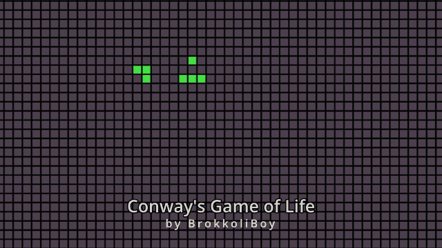
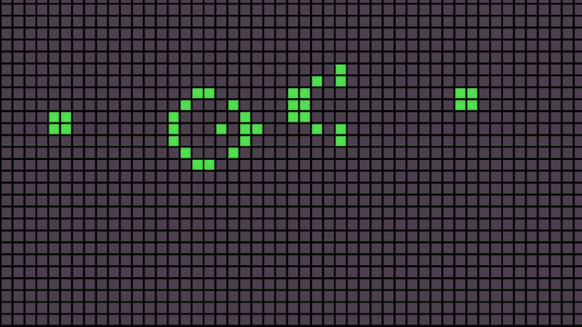
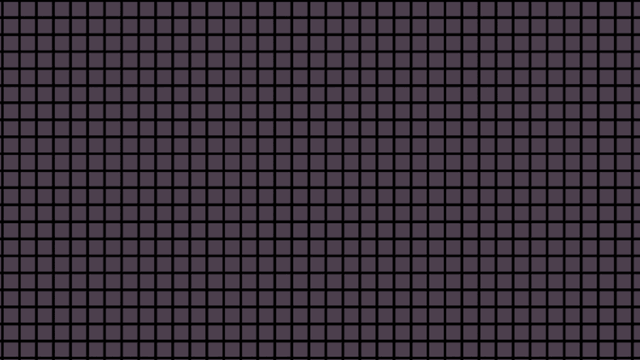
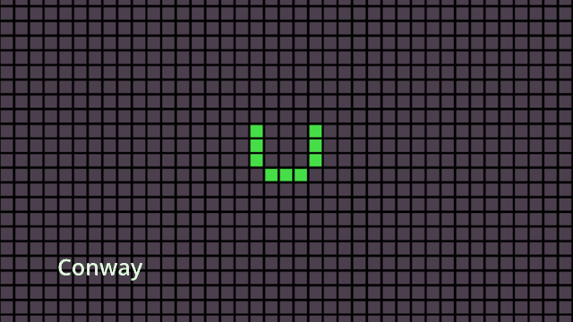

# Conway's Game of Life

**Status:** Finished  |  **Built:** 2021  |  **Role:** Solo developer

A from-scratch Unity implementation of Conway's Game of Life, built in a single weekend to win a bet. Click cells alive or dead, then step through generations by hand or let the simulation run at an adjustable speed.

▶ [Play it in your browser on itch.io](https://brokkoliboy.itch.io/conways-game-of-life)

## Why I built this
My brother described Conway's Game of Life to me as a fascinating but complicated system. I bet him I could implement it from scratch in two days. He took the bet, I built this between Friday evening and Sunday evening, and won. The goal was never to build the most feature-complete version of the game. It was to prove the core idea is actually simple by getting a working implementation running fast, so every design choice here was picked because it was cheap to build within that two-day window, not because it was the best possible approach. Later I came back and added a full settings panel and four additional rule variants on top of that original build.

## What is it?
A Unity simulation of Conway's Game of Life: a grid of cells that live, die, or come to life each generation based on how many neighbors are alive, following the classic ruleset (a dead cell with exactly 3 live neighbors is born, a live cell with fewer than 2 or more than 3 live neighbors dies, everything else stays the same).

## Features
- Standard Conway's Game of Life rules on a wrapping (toroidal) grid

  

- Click and hold the mouse to set cells alive or dead

  

- Randomize the board with an adjustable starting density, or clear it back to empty
- A settings panel with icon buttons and sliders for play/pause, single-step, simulation speed, starting density, and cell fade time
- Five selectable rulesets — Conway's classic rules, HighLife, Day and Night, Seeds, and Maze — each producing very different behavior from the same simulation

  
